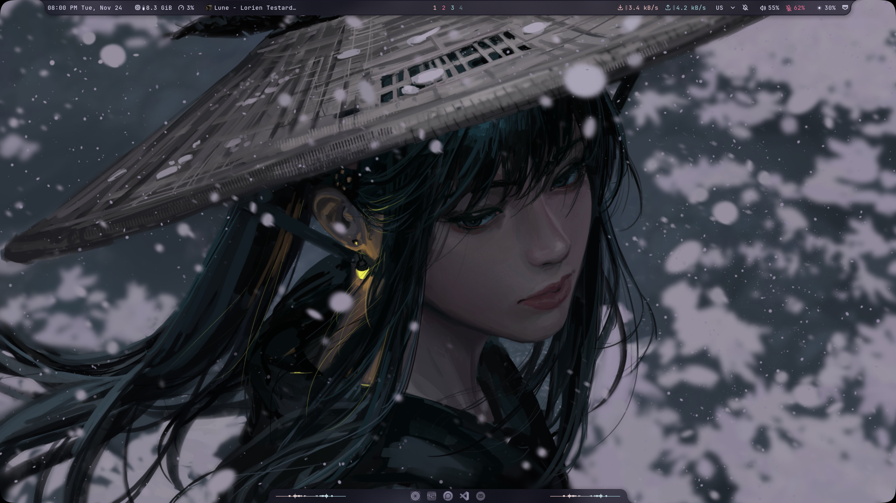

<div align="center">
  <h2>NixOS | Niri | Noctalia</h2>
  <br/><br/>
  
  <br/><br/>
  
</div>

### Stuff

- [NixOS](https://nixos.org/)
- [Niri](https://github.com/YaLTeR/niri)
- [Noctalia](https://github.com/noctalia-dev/noctalia)
- [WezTerm](https://wezfurlong.org/wezterm/)
- [Fish](https://fishshell.com/)
- [Zellij](https://zellij.dev/)
- [Helix](https://helix-editor.com/)
- [MPD](https://www.musicpd.org/) + [RMPC](https://github.com/mierak/rmpc) + [Cava](https://github.com/karlstav/cava)
- [Yazi](https://github.com/sxyazi/yazi) & [Thunar](https://docs.xfce.org/xfce/thunar/start)

### Keybinds

`Mod + /` for the keymap.

<p align="center">
  
</p>

### Layout

```
.
├── flake.nix         entry point: inputs, host metadata, NixOS host, packages, overlays
├── justfile          maintenance recipes
├── hosts/            machine-specific hardware, bootloader, storage, user
├── modules/          NixOS system modules & Home Manager modules
├── packages/         local derivations, wrapped apps, and desktop scripts (pkgs.myPkgs)
├── overlays/         injects pkgs.myPkgs into nixpkgs
├── config/           app config files linked or seeded by Home Manager
├── assets/           binary theme media & screenshots
└── templates/        dev shells for Python, Rust, web, Typst
```

### Commands

Enter the dev shell (`nix develop` or `just develop`) to get `just`, `nixfmt`, `nil`, and `statix`:

| Command | What it does |
| --- | --- |
| `just check` | `nix flake check --no-build --all-systems` |
| `just fmt` | `nix fmt` |
| `just lint` | `statix check .` |
| `just build` | build toplevel without switching |
| `just test` | rebuild into a test profile |
| `just switch` | rebuild and switch |
| `just boot` | rebuild, activate on next boot only |
| `just update` | `nix flake update` |
| `just clean` | keep last 5 generations, run GC |

### Build Notes

- **Noctalia builds from source on your machine (~10 minutes on the first build or after updating Noctalia):** [noctalia.nix](modules/home/desktop/noctalia.nix) patches Noctalia's source so cards, buttons, and panels stay see-through over blurred backgrounds. Because it's modified, Nix can't download the prebuilt binary from Cachix and has to compile it locally. Once built, it stays cached until you update Noctalia or change the patch.
- **Other packages that build or repackage locally:**
  - `perfmode` ([packages/perfmode/default.nix](packages/perfmode/default.nix)) and `niri-float-sticky` ([flake.nix](flake.nix)) compile small helpers from source (quick, a few seconds).
  - `zapfast` ([packages/zapfast/default.nix](packages/zapfast/default.nix)) and `metrolist` ([flake.nix](flake.nix)) repackage prebuilt binaries locally (fast, no compilation).

### Fresh Install

The easiest way to install this setup on a new machine is from an existing basic NixOS install (so your user, password, and `/etc/nixos/hardware-configuration.nix` already exist):

1. **Clone to `~/dotfiles`** (required because several app configs link directly to `~/dotfiles/config/...`):
   ```bash
   git clone <repo-url> ~/dotfiles
   cd ~/dotfiles
   ```
2. **Copy your generated hardware config:**
   ```bash
   cp /etc/nixos/hardware-configuration.nix hosts/nixos/hardware-configuration.nix
   ```
3. **Update the machine-specific settings before building:**
   - [flake.nix](flake.nix) - change `username`, `fullName`, and `email` under `hosts.nixos`.
   - [hosts/nixos/storage.nix](hosts/nixos/storage.nix) - replace with your own extra mounts/subvolumes, or remove `./storage.nix` from [hosts/nixos/default.nix](hosts/nixos/default.nix) (leaving the hardcoded UUIDs will cause boot to fail).
   - [hosts/nixos/boot.nix](hosts/nixos/boot.nix) - check `efiSysMountPoint = "/boot/efi"`. Standard NixOS installs mount EFI at `/boot`, so update it to match your `hardware-configuration.nix`.
   - [hosts/nixos/hardware/nvidia.nix](hosts/nixos/hardware/nvidia.nix) - update `intelBusId` and `nvidiaBusId` (`lspci`), or remove `./hardware/nvidia.nix` from [hosts/nixos/default.nix](hosts/nixos/default.nix) if you don't have hybrid Intel + NVIDIA graphics.
   - [hosts/nixos/hardware/asus.nix](hosts/nixos/hardware/asus.nix) - remove from [hosts/nixos/default.nix](hosts/nixos/default.nix) if not on an ASUS laptop (it blacklists the `mt7921e` Wi-Fi driver, which will disable Wi-Fi on laptops that use that card).
   - [modules/nixos/services/pipewire.nix](modules/nixos/services/pipewire.nix) - remove the `ACP_PATHS_DIR` mixer override line on non-ASUS ALC256 hardware.
   - [config/noctalia/config.toml](config/noctalia/config.toml) & [modules/home/desktop/niri/config.kdl](modules/home/desktop/niri/config.kdl) - replace `eDP-1` with your monitor output name (`niri msg outputs`), and update the wallpaper/avatar paths under `~/Pictures/`.
4. **Build and switch** (pass `--accept-flake-config` on the first build so Nix uses the Cachix caches from `flake.nix` before your system config enables them):
   ```bash
   sudo nixos-rebuild switch --flake .#nixos --accept-flake-config
   ```
   *(If installing directly from a Live USB with `nixos-install --flake .#nixos`, run `nixos-enter --root /mnt -c 'passwd <username>'` before rebooting since [user.nix](hosts/nixos/user.nix) doesn't set a default password.)*

### Docs

- [ARCHITECTURE.md](ARCHITECTURE.md) - detailed layout, custom behaviors, caveats, machine reuse, and manually pinned packages
- [ASSETS.md](ASSETS.md) - binary theme media under `assets/`
- [SECURITY.md](SECURITY.md) - credential & keyring handling
