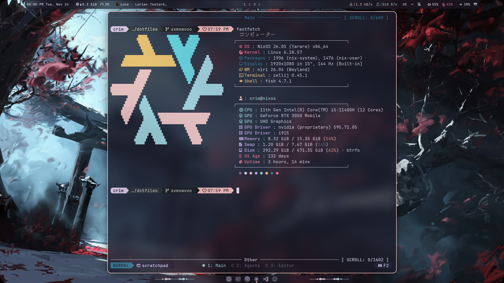
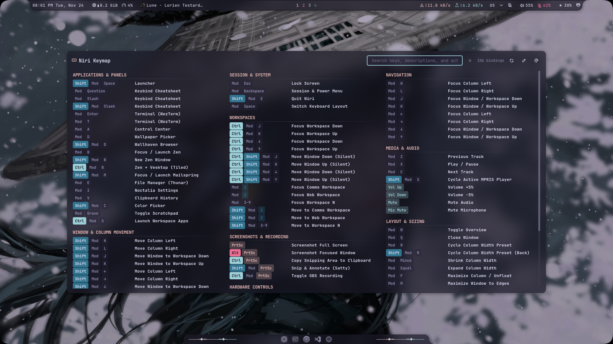

<div align="center">
  <h2>NixOS | Niri | Noctalia</h2>
  <br/><br/>
  
</div>

### Stuff

- [NixOS](https://nixos.org/)
- [Niri](https://github.com/YaLTeR/niri)
- [Noctalia](https://github.com/Noctalia/noctalia)
- [WezTerm](https://wezfurlong.org/wezterm/)
- [Fish](https://fishshell.com/)
- [Zellij](https://zellij.dev/)
- [Helix](https://helix-editor.com/)
- [MPD](https://www.musicpd.org/) + [RMPC](https://github.com/mierak/rmpc) + [Cava](https://github.com/karlstav/cava)
- [Yazi](https://github.com/sxyazi/yazi) & [Thunar](https://docs.xfce.org/xfce/thunar/start)

### Keybinds

`Mod + /` for the keymap.

<p align="center">
  
</p>

### Layout

```
.
├── flake.nix         entry point: inputs, host metadata, NixOS host, packages, overlays
├── justfile          maintenance recipes
├── hosts/            machine-specific hardware, bootloader, storage, user
├── modules/          NixOS system modules & Home Manager modules
├── packages/         local derivations, wrapped apps, and desktop scripts (pkgs.myPkgs)
├── overlays/         injects pkgs.myPkgs into nixpkgs
├── config/           app config files linked or seeded by Home Manager
├── assets/           binary theme media & screenshots
└── templates/        dev shells for Python, Rust, web, Typst
```

### Commands

Enter the dev shell (`nix develop` or `just develop`) to get `just`, `nixfmt`, `nil`, and `statix`:

| Command | What it does |
| --- | --- |
| `just check` | `nix flake check --no-build --all-systems` |
| `just fmt` | `nix fmt` |
| `just lint` | `statix check .` |
| `just build` | build toplevel without switching |
| `just test` | rebuild into a test profile |
| `just switch` | rebuild and switch |
| `just boot` | rebuild, activate on next boot only |
| `just update` | `nix flake update` |
| `just clean` | keep last 5 generations, run GC |

### Docs

- [ARCHITECTURE.md](ARCHITECTURE.md) - detailed layout, custom behaviors, caveats, machine reuse, and manually pinned packages
- [ASSETS.md](ASSETS.md) - binary theme media under `assets/`
- [SECURITY.md](SECURITY.md) - credential & keyring handling
