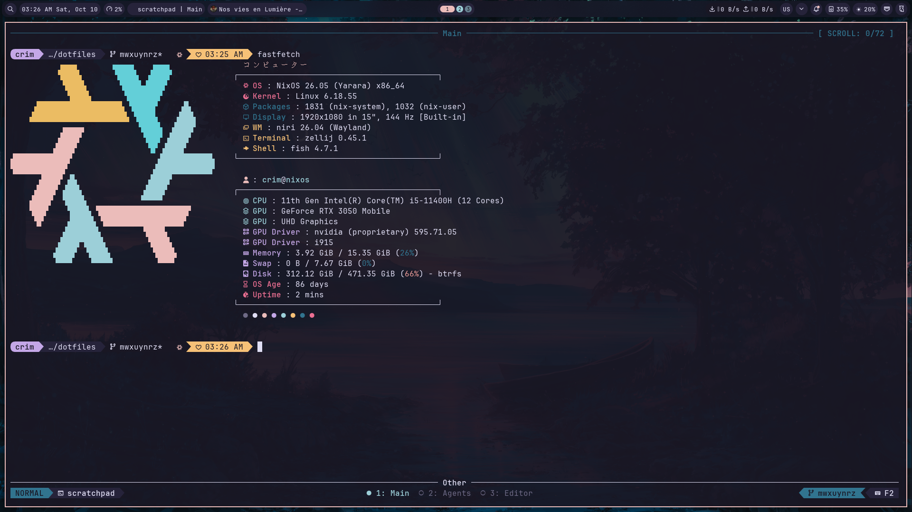
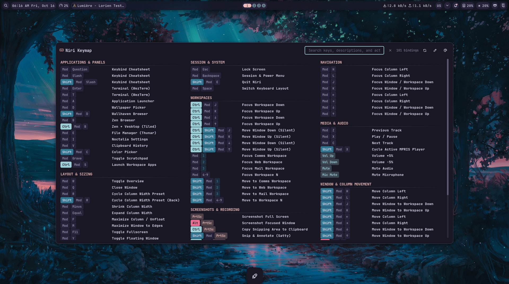

<div align="center">
  <h2>NixOS | Niri | Noctalia</h2>
  <br/><br/>
  
</div>

### Stuff

- [NixOS](https://nixos.org/)
- [Niri](https://github.com/YaLTeR/niri)
- [Noctalia](https://github.com/Noctalia/noctalia)
- [WezTerm](https://wezfurlong.org/wezterm/)
- [Fish](https://fishshell.com/)
- [Zellij](https://zellij.dev/)
- [Helix](https://helix-editor.com/) 
- [MPD](https://www.musicpd.org/) + [RMPC](https://github.com/mierak/rmpc) + [Cava](https://github.com/karlstav/cava)
- [Yazi](https://github.com/sxyazi/yazi) & [PCManFM-Qt](https://github.com/lxqt/pcmanfm-qt)

### Keybinds

`Mod + /` for the keymap. 

<p align="center">
  
</p>

### Layout

```
.
├── flake.nix                      entry point: inputs, host metadata, nixosConfigurations, packages, overlays
├── flake.lock
├── justfile                       common maintenance commands
├── overlays/
│   └── default.nix                overlay injecting pkgs.myPkgs into nixpkgs
├── hosts/
│   └── nixos/                     machine-specific facts (disk UUIDs, bus IDs, etc.)
│       ├── boot.nix               GRUB bootloader, Sekiro theme, dual-boot Pop!_OS entry
│       ├── storage.nix            filesystems, Btrfs subvolumes
│       ├── user.nix               user account creation
│       └── hardware/
│           ├── nvidia.nix         NVIDIA PRIME offload setup
│           └── asus.nix           ASUS quirks (asusd daemon, mt7921e Wi-Fi blacklist, ALC256 audio jack)
├── modules/
│   ├── nixos/                     system-level modules
│   │   ├── base/                  nix settings, core packages
│   │   ├── desktop/               Niri compositor, portals (GNOME/GTK), GVFS
│   │   └── services/              PipeWire, keyd, Podman, Espanso, SDDM, Cloudflare WARP
│   └── home/                      Home Manager modules
│       ├── desktop/               Niri config, official Noctalia HM module
│       ├── programs/              shell, terminal, apps, media, vcs (Git & Jujutsu)
│       ├── services/              MPD, Espanso
│       ├── theme/                 GTK (Rosé Pine) / Qt (Kvantum) / cursor theme
│       └── xdg/                   desktop entries, MIME associations, userDirs
├── packages/                      granular local derivations (exposed as flake packages & pkgs.myPkgs)
│   ├── default.nix                callPackage aggregator for all local derivations
│   ├── plymouth-theme.nix         Hexa-retro Plymouth theme
│   ├── qylock.nix                 Quickshell lockscreen & SDDM theme
│   ├── perfmode/                  perfmode utility package
│   ├── mailspring/                Mailspring wrapped with gnome-libsecret
│   └── scripts/                   standalone utility scripts
│       ├── smart-playerctl.nix    smart MPRIS player switcher (bypasses DND)
│       ├── toggle-scratchpad.nix  Niri scratchpad toggle
│       ├── obs-toggle-record.nix  OBS websocket recording toggle
│       ├── launch-zen-vesktop.nix tiled Zen + Vesktop launcher
│       ├── yt-dlp-wrapped.nix     audio extraction wrapper
│       ├── jj-status.nix          Jujutsu terminal status indicator
│       └── asus/                  ASUS laptop power profile & Aura RGB tools
├── config/                        app config files linked by Home Manager
├── assets/                        binary theme media (SDDM, Plymouth, screenshots)
└── templates/                     dev shells for Python, Rust, web, Typst
```

### Commands

Enter the dev shell to get `just`, `nixfmt`, `nil`, and `statix`:

```shell
nix develop
```

| Command | What it does |
| --- | --- |
| `just check` | `nix flake check --no-build --all-systems` |
| `just fmt` | `nix fmt` |
| `just lint` | `statix check .` |
| `just build` | build toplevel without switching |
| `just test` | rebuild into a test profile |
| `just switch` | rebuild and switch |
| `just boot` | rebuild, activate on next boot only |
| `just update` | `nix flake update` |
| `just clean` | keep last 5 generations, run GC |


### Inputs

Tracks `nixos-26.05`. Third-party flake inputs follow it so the system evaluates against one unified package tree, with the exception of `noctalia` and `llm-agents`, which track their respective upstream branches independently to leverage prebuilt binary caches (`noctalia.cachix.org` and `cache.numtide.com`) and avoid local compilation.

Binary cache substituters and keys are configured in `flake.nix` (`nixConfig`) and `modules/nixos/base/default.nix` (`nix.settings`), with `@wheel` included in `trusted-users`.

### Reusing on another machine

Everything under `hosts/nixos/` is machine-specific. Replace before using:

- `hardware-configuration.nix` - regenerate with `nixos-generate-config`
- `storage.nix` - Btrfs subvolume names and disk UUIDs
- `boot.nix` - GRUB has a hardcoded Pop!_OS entry tied to this machine's EFI UUID
- `hardware/nvidia.nix` - PRIME bus IDs, get them with `lspci`
- `hardware/asus.nix` - ASUS TUF/ROG specific quirks (`asusd`, `mt7921e` blacklist, audio jack quirk); omit if non-ASUS
- host metadata in `flake.nix` (`username`, `fullName`, `email`)

`modules/` and `packages/` are completely reusable across machines without modification. No usernames or paths are hardcoded, Noctalia dynamically substitutes `@HOME@` on activation.

### Notes

- Kernel is `pkgs.linuxPackages` (stable) to avoid out-of-tree NVIDIA module build failures on newer kernels.
- 32-bit graphics (`hardware.graphics.enable32Bit = true`) is enabled for 32-bit Wine/Proton games.
- The file chooser uses the modern GTK4 / Libadwaita GNOME portal (`xdg-desktop-portal-gnome`), pre-warmed via systemd user services for instant (<100ms) launch without cold-start delays. GTK recent file scanning is disabled to prevent disk freezes.
- Desktop scripts (`smart-playerctl`, `asus-profile-switch`, `asus-aura-mode`) send critical priority notifications configured to bypass Noctalia's Do Not Disturb mode.
- MPD listens on a UNIX domain socket (`~/.config/mpd/socket`) for RMPC, Cava visualizer, and yt-dlp integration.
- Git and Jujutsu identity come from `flake.nix` and are rendered read-only in `modules/home/programs/vcs.nix`.
- `system.stateVersion` and `home.stateVersion` are pinned. Don't bump them when the channel updates.
- Cloudflare WARP needs `warp-cli register` once after first switch to activate.
- Running `just switch` applies `trusted-users` so unprivileged commands (`just build`) can substitute prebuilt binaries directly from Cachix.
